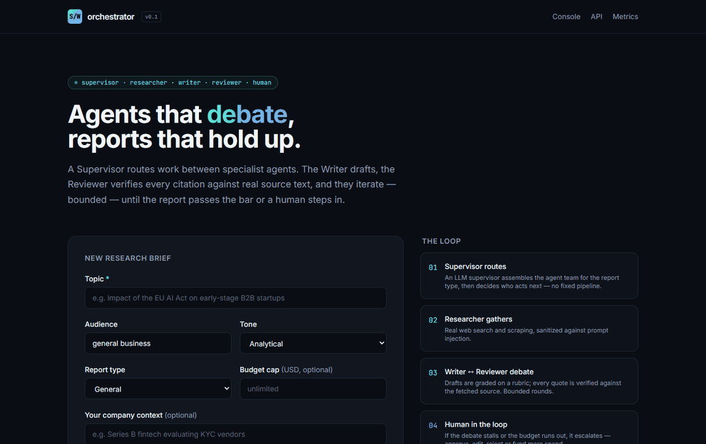
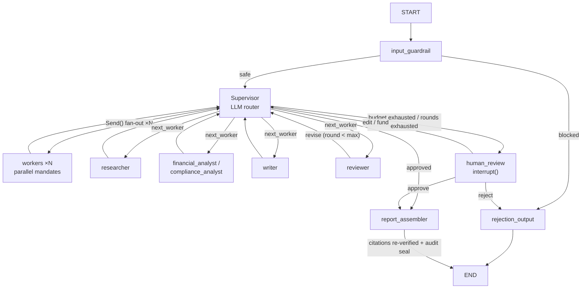
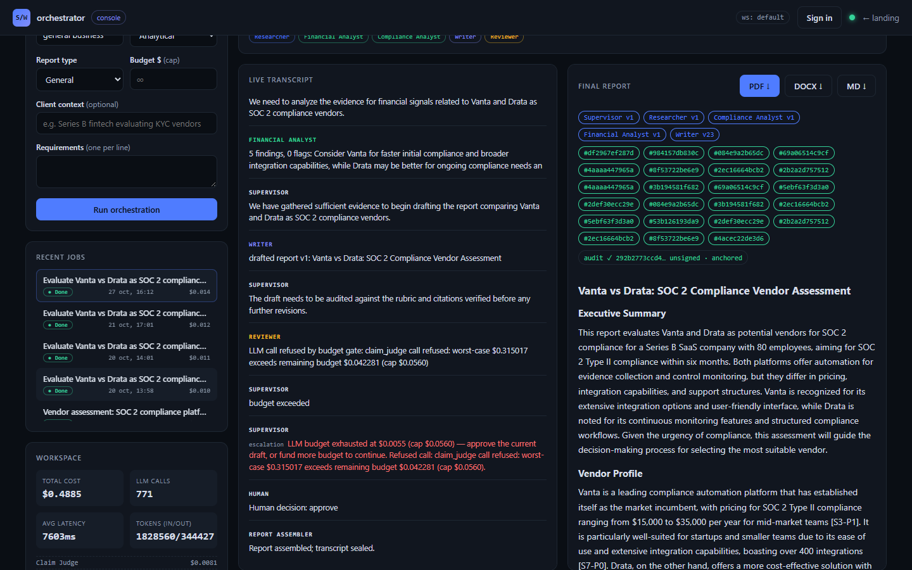
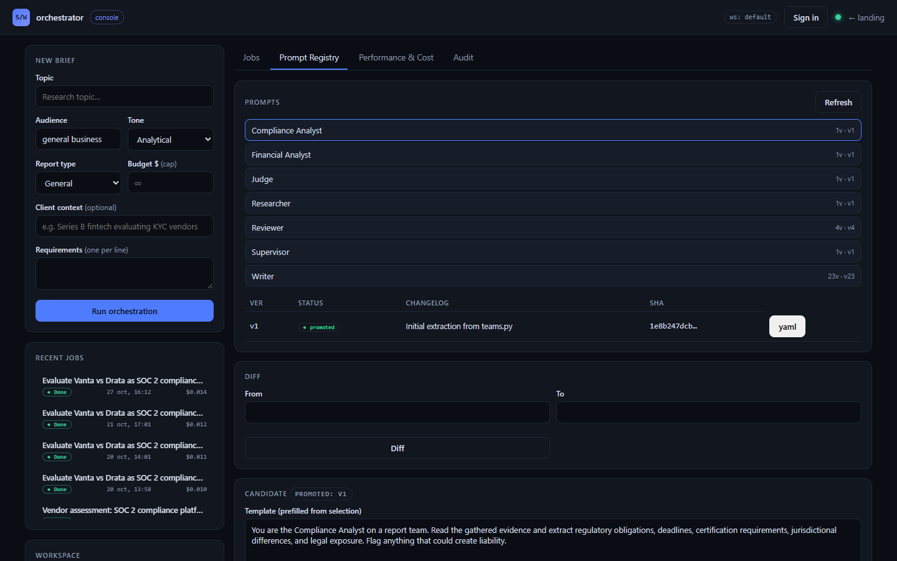
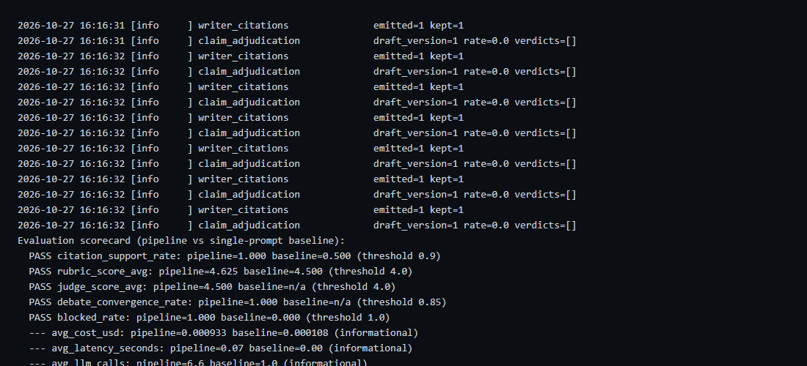
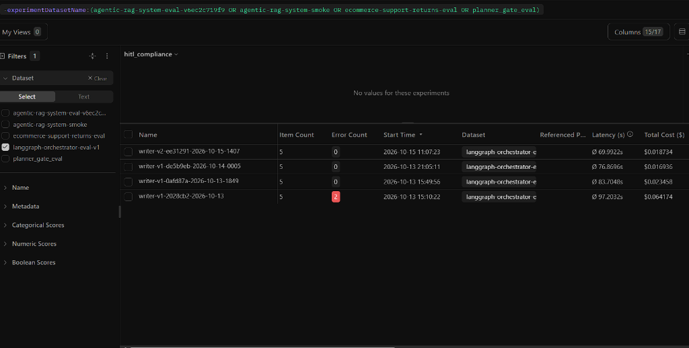
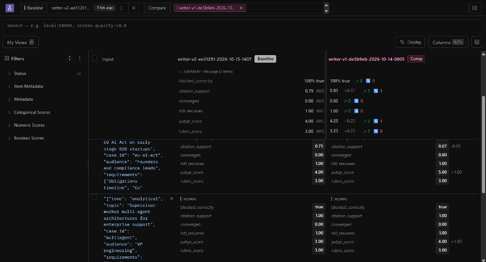
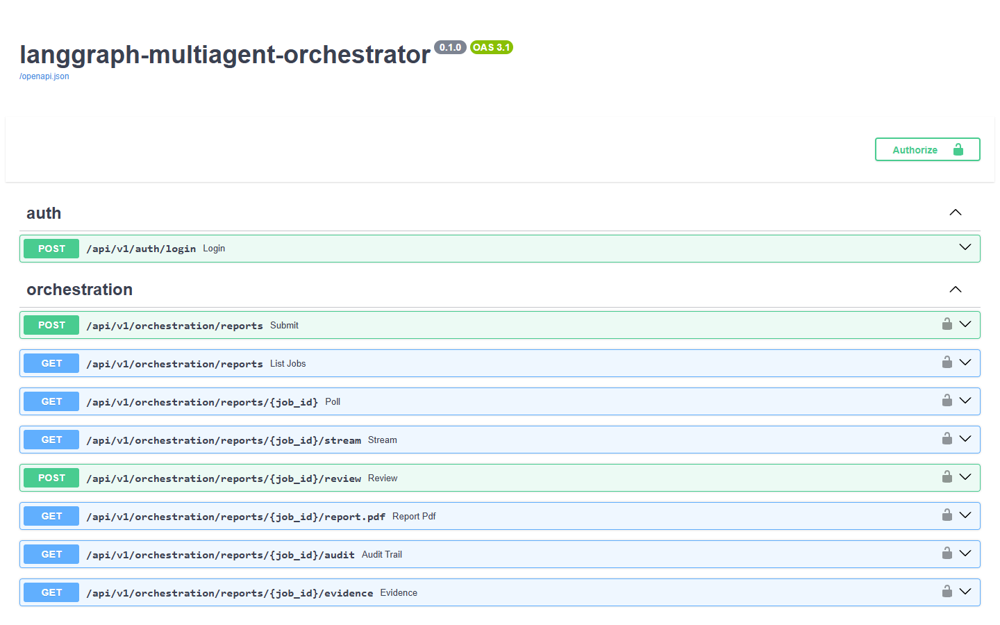

<div align="center">

# 🧭 LangGraph Multi-Agent Orchestrator

**A multi-tenant Supervisor–Workers platform where companies commission auditable B2B reports — the system assembles the right agent team per report type, works in parallel when the Supervisor decides, stays inside the budget you set, and seals every delivery with a cryptographic dossier of the debate that produced it.**

[](https://www.python.org/)
[](https://fastapi.tiangolo.com/)
[](https://github.com/langchain-ai/langgraph)
[](https://github.com/kanderson-ai-dev/langgraph-multiagent-orchestrator/actions/workflows/ci.yml)
[](https://github.com/kanderson-ai-dev/langgraph-multiagent-orchestrator/actions/workflows/ci.yml)
[](https://github.com/astral-sh/ruff)
[](https://mypy-lang.org/)
[](LICENSE)



</div>

---

## 📌 What this is

A **production-shaped, multi-tenant orchestration microservice** built with
FastAPI and LangGraph. A company submits a report brief — topic, report type,
audience, client context, budget cap — and the platform deploys a **team of
specialized agents** chosen for that report type. An LLM **Supervisor** routes
work dynamically (no fixed edges), fans work out in parallel through LangGraph
`Send()` when the mandate calls for it, and drives a bounded **Writer ↔
Reviewer debate** until the draft passes a rubric — or escalates to a human
with the real reason. Every finished job ships a report with verified
citations, a downloadable PDF, and a **SHA-256 hash-chained audit trail** of
the entire debate.

This is the step beyond a fixed planner→workers→critic pipeline: the team,
the routing, and the parallelism are all runtime decisions, the autonomy is
**cost-governed**, and the deliverable is **tamper-evident** — engineered to
the standard of a paid engagement, not a portfolio toy.

---

## 💡 Why this matters — for your project, or for a technical reviewer

- 🧩 **A real framework, not a demo graph.** `app/framework/` holds the
  domain-agnostic Supervisor–Workers primitives (`worker.py`, `supervisor.py`,
  `debate.py`, `registry.py`). The report graph is one concrete assembly —
  adding a specialist is a class plus one registry line.
- 🤖 **Dynamic teams per report type.** `vendor_assessment` deploys
  Researcher + Financial Analyst + Compliance Analyst + Writer + Reviewer;
  `general` deploys the core trio. The Supervisor only routes inside the
  team the brief bought.
- 🧠 **Dynamic routing, not fixed edges.** The Supervisor is an LLM decider
  that sees the live state and picks the next worker — or emits parallel
  `Send()` dispatches under a mandate. Guards against pathological loops are
  structural: per-worker dispatch caps + global bounds + budget enforcement.
- 💰 **Cost-governed autonomy.** A per-job `budget_usd` is enforced *before*
  each dispatch — when the cap is hit the job escalates to a human who can
  **fund and continue**, approve, edit, or reject. The console shows cost by
  agent role in real time.
- 🔁 **A debate that must terminate.** Writer and Reviewer iterate bounded
  rounds (`MAX_DEBATE_ROUNDS`); the Reviewer grades against a rubric and
  verifies citation support. Exhausted rounds escalate — guaranteed
  termination is proven by a dedicated test, not by luck.
- 🔏 **Tamper-evident delivery.** Every transcript entry joins a SHA-256
  hash chain; the report carries its `audit_root`, and
  `GET /reports/{id}/audit` lets anyone re-verify the chain. For B2B
  compliance work, "who said what and when" is cryptographic, not anecdotal.
- 🧑‍⚖️ **Honest human-in-the-loop.** A real LangGraph `interrupt()` on a
  SQLite checkpointer — jobs pause at `awaiting_review`, survive restarts,
  and resume with `Command(resume=...)`. The UI shows *why* it escalated
  (LLM budget vs. debate rounds) and adapts its actions accordingly.
- 🏢 **Multi-tenant from day one.** `workspace_id` scopes every job, event
  and report — one tenant can never read another's work.
- 🧪 **CI green with zero secrets.** 354 tests, 92% coverage on `app/`,
  `mypy --strict`, a browser E2E smoke test — all runnable offline via a
  deterministic `StubLLM` and fixture-based tools. `docker compose up` works
  with no credentials at all.

---

## 🏗️ Architecture



**Dynamic teams by `report_type`:**

| Report type | Deployed team |
|---|---|
| `general` | Researcher, Writer, Reviewer |
| `market_intelligence` | + Financial Analyst |
| `competitive_landscape` | + Financial Analyst |
| `vendor_assessment` | + Financial Analyst, Compliance Analyst |
| `technical_due_diligence` | + Compliance Analyst |

### Two frontend surfaces

| Route | Surface |
|---|---|
| `/` | Minimalist public landing (Tailwind via CDN, no build step). |
| `/console` | Operator console (bundler-free ES modules) — brief submission, live SSE transcript with Supervisor dispatches and the Writer↔Reviewer debate, guided HITL review modal, per-role cost panel, Prompt Registry tab, Performance & Cost tab, Audit tab, sealed report with clickable sources and PDF/MD/DOCX download. |



---

## 🧬 Prompt Registry

Prompts are versioned artifacts, not string literals buried in nodes.
`prompts/<name>/vN.yaml` seeds load idempotently into a SQLite-backed
registry that owns the lifecycle:

```
seed → draft → candidate ──ab-test──▶ promoted ──▶ retired
                    │                    ▲
                    └── metric gate (PROMPT_PROMOTION_EPSILON) or
                        admin override (reason is audit-logged)
```

- **Provenance on every call**: each LLM generation carries
  `prompt_name` / `prompt_version` / `prompt_sha256` in trace metadata —
  a LangSmith/Langfuse trace answers "which template produced this".
- **Metric-gated promotion**: `run_ab_eval` scores the candidate against
  the champion on the golden dataset; promotion below the epsilon gate is
  blocked unless an admin supplies an override reason.
- **Tamper-evident lifecycle**: every mutation appends to the same
  hash-chain family as job transcripts — prompt evolution is auditable.
- **Console tab**: versions, diffs, candidate editor, A/B runs,
  promote/rollback, per-version YAML export — all driven by
  `GET/POST /api/v1/prompts/*`.
- **Two-path creation**: `POST /prompts/{name}/candidates` writes a
  `source='runtime'` row in SQLite only. To bring a reviewed candidate
  under git, export it —
  `GET /prompts/{name}/versions/{v}/yaml` (`text/yaml`, viewer role),
  the console's `yaml` button, or
  `uv run python scripts/export_prompt.py <name> <v> --write`
  (never overwrites an existing file) — and commit the produced
  `prompts/<name>/v<v>.yaml`. On the next startup the file is adopted:
  an identical template hash flips the row to `source='yaml'`; a
  **different** hash fails fast with a conflict error — a committed seed
  never silently shadows a runtime version (or vice versa).



## 🔏 Audit & evidence sealing

Two chains make "who said what, backed by what" cryptographic:

- **Transcript chain** — every `AgentMessage` (dispatch, draft, verdict,
  escalation, resume) is appended with a SHA-256 link to its predecessor;
  the report carries the resulting `audit_root`.
- **Evidence manifest** — every source the Researcher fetched is hashed
  (`sha256` of normalized content) at gather time and sealed into the
  chain. Report footnotes carry `#<sha[:12]>` so a citation can be traced
  to the exact bytes that supported it.

`GET /reports/{id}/audit` re-verifies the chain server-side; a tampered
record flips `verified` to `false` (proven by test). `/evidence` exposes
the sealed manifest.

## 🛂 RBAC & workspaces

Multi-tenancy is enforced by *role × workspace*:

| Role | Can do |
|---|---|
| `admin` | Everything: members, API keys, prompt lifecycle, feedback export |
| `member` | Submit/review jobs, read own workspace |
| `viewer` | Read-only within the workspace |

`POST /api/v1/workspaces` + `/members` + `/api-keys` are the admin
surface; JWT sessions resolve `role` from the `members` table, and API
keys carry their role inline. Cross-tenant probes return `404` — resource
existence is not leaked. The dev-mode bootstrap keeps local ergonomics:
with no `JWT_SECRET_KEY`, every request is a default-workspace admin.

---

## 📊 Evaluation-Driven Development (EDD)

Quality thresholds gate CI the same way unit tests do. `evaluation/` contains
a versioned dataset, a deterministic offline harness, and evaluators for the
metrics that matter in this domain.

### Project Goal & Definition of Success

| Dimension | Metric | Success threshold | Latest offline scorecard |
|---|---|---|---|
| Citation faithfulness | Claims backed by real source text | ≥ 0.90 | **1.000** ✅ |
| Task performance | Reviewer rubric (1–5) | avg ≥ 4.0 | **4.500** ✅ |
| Orchestration health | Debate convergence within `MAX_DEBATE_ROUNDS` | ≥ 0.85 | **1.000** ✅ |
| Safety | Adversarial briefs blocked | 1.00 | **1.000** ✅ |
| Latency | Full job wall-clock, live path | p50 ≤ 90s / p95 ≤ 240s | **~105s to HITL/done observed** (was 150–670s before parallel search+scrape) — converged runs land near the p50 target; see Known limitations |
| Cost | Per job (all roles, all rounds) | ≤ $0.08 | **$0.010–$0.104 observed** ✅ (upper end = full 3-round debate + fund) |
| UI end-to-end | Browser E2E: real console → submit → SSE transcript → rendered report → clickable sources | runs in CI (Playwright) | **PASS** ✅ |
| Test coverage | `pytest --cov=app` | ≥ 80% | **92%** ✅ |
| Static typing | `mypy --strict app/` | 0 errors | **0 errors** ✅ |

```bash
uv run python -m evaluation.run_eval   # exits non-zero if any gate fails
```

The offline scorecard measures *pipeline* determinism with a stubbed LLM and
fixture-based tools — guardrails, routing, debate, citation verification and
audit sealing behave correctly without spending a cent. The same metrics run
against the live model with real credentials. Never adjust a badge to look
better than the measured number.

### Baseline comparison (single prompt vs pipeline)

Every eval case also runs a **single-prompt baseline** — one LLM call that
drafts straight from the brief and the *same* evidence bundle: no supervisor,
no debate, no citation verification, no input guardrail. It's the honest
counterfactual the orchestration has to beat. Latest offline scorecard
(`evaluation/results/scorecard.json` — informational, never gated):

| Metric | Pipeline | Baseline |
|---|---|---|
| Citation support rate | **1.000** | 0.500 |
| Reviewer rubric (1–5) | 4.500 | 4.500 |
| Blocked-rate on injection cases | **1.000** | 0.000 |
| Avg LLM calls | 3.6 | 1.0 |
| Avg cost per case (stub-estimated tokens) | $0.000219 (+$0.000063 judge) | **$0.000108** |
| Avg latency (stub) | 0.02s | **~0.00s** |

Read this honestly: the offline stub *models* the classic single-shot failure
(one grounded + one fabricated quote) so the table shows what citation
verification and the input guardrail are *for* — the baseline ships an
unverifiable quote and happily answers the injection brief. The baseline is
also genuinely cheaper and faster, and rubric parity under the stub proves
nothing about real-model quality — that comparison is a live-eval question
the credential-gated workflow answers. What the pipeline buys is
verification, safety, and bounded self-correction — at ~2× the stub-token
cost and 3× the calls of a single prompt.



### Live experiments (LangSmith / Langfuse)

The same dataset pushed through a live provider — per-case evaluator
scores, including the `blocked-injection` adversarial case blocked with
zero tokens spent, exactly as designed. The current live backend is
**Langfuse** (`TRACING_PROVIDER=langfuse`; LangSmith's monthly quota ran
out — see [`docs/eval/why-langfuse.md`](docs/eval/why-langfuse.md)):



Every run name is `<prompt_version>-<git sha>-<date>`, which makes the
Prompt Registry A/B gate a first-class Langfuse comparison — below,
candidate **writer v2** (exact section structure + targeted revision)
measured against promoted **v1** on the same dataset:



`converged` reads 0.00 on every live run: the Writer↔Reviewer debate
exhausts its 3-round budget without the Reviewer issuing `approve`, so a
human approves via `interrupt()` (`hitl_resumes` = 1.00). Reports still
deliver; convergence-without-escalation is the open quality gap the A/B
gate exists to close.

Live surfaces publish **measured results only** — there is deliberately
no stub fallback for `--langsmith-live`/`--langfuse-live` (see
[ADR 0004](docs/adr/0004-live-scorecard-no-offline.md)). That is why a
live run honestly shows non-converged debates and `awaiting_review`
escalations where the offline gate shows green: the stub proves
determinism, the live run proves quality.

---

## 🔌 API

**Orchestration** (all workspace-scoped):

| Endpoint | Purpose |
|---|---|
| `POST /api/v1/auth/login` | Issue a short-lived JWT (rate-limited; only when auth is configured) |
| `POST /api/v1/orchestration/reports` | Submit a report brief → `202` + job record |
| `GET /api/v1/orchestration/reports` | List jobs (workspace-scoped) |
| `GET /api/v1/orchestration/reports/{id}` | Poll status, team, cost and result |
| `GET /api/v1/orchestration/reports/{id}/stream` | Live progress via SSE (per-node events, HITL interrupts) |
| `POST /api/v1/orchestration/reports/{id}/review` | HITL decision — the server publishes `allowed_actions` per pause and rejects off-menu actions |
| `GET /api/v1/orchestration/reports/{id}/report.{pdf,md,docx}` | Download the final report |
| `GET /api/v1/orchestration/reports/{id}/audit` | Hash-chained audit trail + server-side verification |
| `GET /api/v1/orchestration/reports/{id}/evidence` | Sealed evidence manifest (per-source SHA-256) |

**Prompt Registry** (lifecycle mutations are `admin`-only):

| Endpoint | Purpose |
|---|---|
| `GET /api/v1/prompts` `/{name}` `/{name}/diff` | Versions, detail, rendered diff |
| `GET /api/v1/prompts/{name}/versions/{v}/yaml` | Export a version as a seed-shaped YAML file |
| `POST /api/v1/prompts/{name}/candidates` | Register a candidate version |
| `POST /api/v1/prompts/{name}/ab-test` `/promote` `/rollback` | Measured A/B → gated promotion / instant rollback |
| `GET /api/v1/prompts/ab-runs/{run_id}` `/audit` | A/B results, lifecycle audit chain |

**Workspaces, ops & public:**

| Endpoint | Purpose |
|---|---|
| `POST /api/v1/workspaces` `/{id}/members` `/{id}/api-keys` | Workspace administration (admin-only) |
| `GET /api/v1/dashboard/summary` `/performance` | Workspace cost/token/latency + p50/p95 and human-vs-agent comparison |
| `POST /api/v1/feedback` · `GET /api/v1/feedback` `/export` | Report feedback queue (write: any member; read/export: admin) |
| `GET /api/v1/config/ui` | White-label config the frontends apply (`UI_*` envs) |
| `GET /status` · `GET /eval/latest` | Public status page + latest published scorecard |
| `GET /health/live` `/health/ready` `/api/v1/health` `/metrics` | Probes + Prometheus exposition |



### curl examples

```bash
# Submit a vendor-assessment brief with a $0.05 cost cap
curl -s -X POST http://localhost:8000/api/v1/orchestration/reports \
  -H "Content-Type: application/json" \
  -d '{
    "topic": "Compare Vanta and Drata SOC 2 evidence practices",
    "report_type": "vendor_assessment",
    "audience": "procurement team",
    "tenant_context": "Fintech scale-up, 120 employees",
    "budget_usd": 0.05
  }'

# Poll status / cost / result
curl -s http://localhost:8000/api/v1/orchestration/reports/<job_id>

# Stream live progress (supervisor dispatches, debate, interrupts)
curl -N http://localhost:8000/api/v1/orchestration/reports/<job_id>/stream

# Resolve a job paused for human review — fund or approve
curl -s -X POST http://localhost:8000/api/v1/orchestration/reports/<job_id>/review \
  -H "Content-Type: application/json" \
  -d '{"action": "fund", "additional_budget_usd": 0.05}'

# Download the sealed report / inspect the audit chain
curl -s -o report.pdf http://localhost:8000/api/v1/orchestration/reports/<job_id>/report.pdf
curl -s http://localhost:8000/api/v1/orchestration/reports/<job_id>/audit
```

---

## 📡 Observability & cost

- **structlog** JSON pipeline, correlated by `job_id`, with automatic
  redaction of `*_key` / `*_token` / `*_password` / `authorization` /
  `*_secret` fields.
- **Prometheus** metrics for job outcomes, durations, tokens by role,
  per-node latency histograms (`node_seconds`) and per-job cost —
  `docs/observability/grafana-dashboard.json` imports as-is.
- **`GET /api/v1/dashboard/performance`**: measured p50/p95 per node and
  per job, cost per job against a versioned model price table, and a
  human-vs-agent comparison (`HUMAN_HOURS_PER_REPORT`,
  `HUMAN_HOURLY_USD`) — the console renders it in the Performance tab.
- **Per-job cost accounting**: a context-scoped `UsageTracker` rolls every
  LLM call into `job.cost_usd`, split by agent role in the console.
- **LangSmith**: set `LANGCHAIN_API_KEY` + `LANGCHAIN_TRACING_V2=true` and
  every run is traced — `evaluation/run_eval.py --langsmith` pushes the EDD
  dataset as a versioned experiment.
- **Langfuse** (fallback backend, `TRACING_PROVIDER=langfuse`): OTel-based
  tracing via the `langfuse` SDK — one trace per job (HITL resumes rejoin
  it), per-generation `prompt_version`/hash metadata, payload masking
  (secrets + system-prompt text) before export, and a `X-Trace-Id` response
  header on job submit. `run_eval.py --langfuse-live` publishes the same
  EDD dataset + scores as a Langfuse experiment; `docker-compose.langfuse.yml`
  offers an optional self-host stack. When Langfuse wins the provider slot,
  LangSmith export stays off — never double-traced. With no keys it is a
  silent no-op, so CI and offline tests never touch the network.
- **Checkpoints**: LangGraph `AsyncSqliteSaver` per `job_id` — paused jobs
  survive restarts and resume exactly where the `interrupt()` fired.

---

## 🔒 Security posture

Guardrail-first design (hostile briefs are rejected before any paid call),
scraped content treated as data never instructions (OWASP LLM01 — injection
fixtures tested), JWT auth + role-based access control (admin/member/viewer)
with generic 401s, rate limiting (in-memory or Redis), security headers
middleware, robots.txt-compliant scraper with delays and size caps,
`workspace_id` isolation on every route (cross-tenant probes → `404`),
admin-only prompt lifecycle with an audit-chained trail, and secret hygiene
enforced by `SecretStr`, redacted logs, `.gitignore`/`.dockerignore`
coverage, `gitleaks` + `pip-audit` + SBOM/CodeQL/Dependabot in CI. Full
mapping: [`SECURITY.md`](SECURITY.md).

---

## 🚀 Quick Start

```bash
uv sync --all-extras
cp .env.example .env        # OPENAI_API_KEY / SEARCH_API_KEY as needed
uv run uvicorn app.main:app --reload
# open http://localhost:8000/          → landing
# open http://localhost:8000/console/  → operator console
```

The app **degrades cleanly with zero secrets**: no LLM key → deterministic
`StubLLM`; no search key → keyless DuckDuckGo (or `SEARCH_PROVIDER=none` for
fully offline); no JWT secret → auth disabled for local dev. CI runs the
entire suite with no secrets at all.

```bash
docker compose up --build   # PORT=8001 docker compose up --build to remap
```

The image is non-root, health-checked, and persists jobs + checkpoints to a
named volume; `.env` is read at runtime — no secrets are baked in.

## ⚙️ Environment Variables

| Variable | Required | Secret? | Purpose |
|---|---|---|---|
| `OPENAI_API_KEY` | no | ✅ | Supervisor + workers LLM; deterministic stub when absent |
| `CHAT_MODEL_NAME` | no | — | Model override (default `gpt-4o-mini`) |
| `SEARCH_PROVIDER` | no | — | `auto` \| `tavily` \| `duckduckgo` \| `none` |
| `SEARCH_API_KEY` | no | ✅ | Tavily key (enables the paid provider) |
| `LANGCHAIN_API_KEY` / `LANGCHAIN_TRACING_V2` | no | ✅ | LangSmith tracing + eval experiments |
| `TRACING_PROVIDER` | no | — | `langsmith` \| `langfuse` \| `none` (default) |
| `LANGFUSE_PUBLIC_KEY` / `LANGFUSE_SECRET_KEY` | no | ✅ | Langfuse tracing + experiments |
| `LANGFUSE_BASE_URL` | no | — | Langfuse region/self-host (default cloud) |
| `JWT_SECRET_KEY` / `ADMIN_PASSWORD_HASH` / `ADMIN_USERNAME` | no | ✅ | Enables JWT auth (else open local dev) |
| `MAX_DEBATE_ROUNDS` | no | — | Writer↔Reviewer cap before escalation |
| `SUPERVISOR_MAX_DISPATCHES` | no | — | Hard bound on Supervisor routing steps |
| `PROMPT_EVAL_TIMEOUT_SECONDS` | no | — | Per-eval bound for A/B + promotion runs |
| `MAX_WORKER_DISPATCHES` | no | — | Per-worker dispatch cap (anti-loop guard) |
| `MAX_SUB_QUESTIONS` | no | — | Researcher query fan-out bound |
| `DEFAULT_JOB_BUDGET_USD` | no | — | Global fallback budget cap per job |
| `REVIEWER_MODEL` / `LLM_MAX_TOKENS` | no | — | Model override per role / output cap per call |
| `RESEARCH_SCRAPE_TOP_K` | no | — | Sources scraped per sub-question |
| `REVIEW_EARLY_EXIT_SCORE` / `REVIEWER_CITATION_SHORTCIRCUIT` | no | — | Skip/defer review work when deterministically decidable |
| `CACHE_ENABLED` / `CACHE_TTL_HOURS` | no | — | Search/scrape response cache (SQLite, per workspace+day) |
| `REDIS_URL` | no | — | Enables Redis-backed rate limiter + event bus (multi-replica) |
| `RATE_LIMIT_PER_MINUTE` | no | — | Sliding-window request cap per workspace |
| `HITL_EXPIRY_HOURS` / `HITL_SWEEP_INTERVAL_SECONDS` | no | — | Stale `awaiting_review` expiry + sweep cadence |
| `HUMAN_HOURS_PER_REPORT` / `HUMAN_HOURLY_USD` | no | — | Baseline for the human-vs-agent performance panel |
| `PROMPT_PROMOTION_EPSILON` | no | — | Minimum measured delta for prompt promotion |
| `JUDGE_MODEL` | no | — | Model for the eval-time LLM judge |
| `UI_PRODUCT_NAME` / `UI_ACCENT_COLOR` / `UI_LOGO_URL` | no | — | White-label config served at `/api/v1/config/ui` |

Never commit secrets. See [`.env.example`](.env.example) for the full,
commented template.

## 📁 Project Structure

```
app/
├── framework/         # domain-agnostic Supervisor–Workers primitives
│                      # (worker protocol, LLM supervisor router, bounded
│                      #  debate loop, worker registry)
├── graph/             # report-generation assembly: state, nodes/
│                      # (researcher/writer/reviewer/specialists), teams,
│                      # prompts, guardrails, citations, report_assembler,
│                      # hitl (guided review actions)
├── api/v1/routes/     # auth, orchestration, prompts, workspaces,
│                      # dashboard, feedback, status, health
├── core/              # config, security, logging, metrics, cost_tracking,
│                      # rate_limit + event_bus protocols, dependencies
└── services/          # llm_client (real + StubLLM), search_client,
                       # scraper_client, job_store, usage_store,
                       # prompt_registry, feedback_store, cache_store,
                       # workspace_store, tracing, job_runner (SSE),
                       # audit (hash chain), exports (pdf/md/docx)
evaluation/            # EDD dataset, evaluators, run_eval, scorecards,
                       # cassettes + record_cassettes, latency_bench,
                       # trend history, langsmith/langfuse publishers
frontend/              # `/` landing (Tailwind CDN) + `/console` operator UI
                       # (ES modules: views/{jobs,report,review,prompts,
                       #  performance,audit}.js)
tests/                 # 354 tests — offline by default, incl. browser E2E
docs/                  # adr/, eval/, observability/ (Grafana), ui-qa/,
                       # functional-qa/, screenshots/
scripts/               # record_demo.py (GIF), capture_screenshots.py,
                       # export_feedback.py
.github/workflows/     # ci.yml (py3.11/3.12 matrix + docker smoke + SBOM),
                       # codeql.yml, live-eval.yml, dependabot.yml
```

## 🧪 Verification

```bash
ruff check .                                            # lint
mypy --strict app/                                      # types (0 errors)
pytest -v --cov=app                                     # 354 tests, offline, 92%
uv run --with playwright pytest tests/test_frontend_e2e.py  # browser E2E
uv run python -m evaluation.run_eval                    # EDD quality gate
uv run python -m evaluation.latency_bench               # p50/p95 bench (live creds)
uv run pip-audit && gitleaks detect                     # supply chain + secrets
```

CI (`.github/workflows/ci.yml`, Python **3.11 + 3.12** matrix): `uv sync
--frozen` → ruff → mypy strict → pytest+coverage → EDD gate → Playwright
browser E2E → pip-audit → gitleaks → Docker build + `/api/v1/health`
container smoke → CycloneDX SBOM generation + validation. All actions are
SHA-pinned; CodeQL runs weekly, Dependabot opens grouped updates, and the
credential-gated `live-eval.yml` publishes scorecards/trends as artifacts.
Versioned QA checklists live in `docs/ui-qa/` + `docs/functional-qa/`.

## 🛠️ Stack

Python 3.11+ · FastAPI · LangGraph (dynamic routing, `Send()` fan-out,
`interrupt()` HITL, `AsyncSqliteSaver`) · LangChain + `langchain-openai` ·
Pydantic v2 / pydantic-settings · httpx (HTTP/2 pooled) + tenacity ·
BeautifulSoup4/lxml + pypdf/pdfplumber · aiosqlite · structlog ·
prometheus-fastapi-instrumentator · PyJWT · fpdf2 + python-docx ·
redis/fakeredis (optional scale-out) · Langfuse/LangSmith tracing ·
pytest/respx · ruff · mypy --strict · Playwright · uv · Docker.

## 🧮 Horizontal scale (optional Redis backends)

The rate limiter and the SSE event bus sit behind `RateLimiter` and
`EventBus` protocols (`app/core/`). Single-process deployments use the
in-memory implementations; setting `REDIS_URL` auto-selects the Redis
backends so multiple replicas share limits and any replica can stream
any job's events:

```bash
REDIS_URL=redis://localhost:6379/0
```

`docker-compose.override.yml` ships an optional Redis service (not
loaded by default):

```bash
docker compose -f docker-compose.yml -f docker-compose.override.yml up
```

Both backends pass the same parametrized contract test suite — CI uses
`fakeredis`, never a real Redis. Other shared state: the prompt registry
re-reads its SQLite overlay whenever the lifecycle chain grows (a promote
in one process is visible in another sharing the file — single host only),
A/B run records persist in `prompt_ab_runs` so they survive restarts, and
the runner frees per-job dicts at terminal states. Remaining scale-out
step: a `JobStore` protocol with a Postgres implementation (SQLite today
is single-node).

## Known limitations & next steps

- **Live debate convergence is below target**: the live Langfuse
  experiment showed the Reviewer exhausting rounds on some briefs
  (`awaiting_review` instead of converged) — the offline stub cannot
  reproduce this. Next step is prompt iteration on the writer/reviewer
  pair via the registry's A/B gate, not a routing change.
- **Live latency sits near (not under) the p50 target**: parallel search +
  bounded-concurrency scraping brought wall-clock from 150–670s down to
  ~105s for a full 3-round debate job. The remaining serial cost is the
  Writer↔Reviewer debate itself — sequential by design — plus keyless
  search latency; a paid provider (Tavily) would shave the research phase
  further.
- The SQLite stores run WAL + a 5 s busy timeout (concurrency-tested —
  see ADR 0003) but remain single-node, single-writer; the next step is
  a `JobStore` protocol + Postgres implementation for true multi-replica
  state (the rate limiter and event bus already have Redis backends).
- LLM-as-judge and live experiments require live credentials; the
  offline scorecard intentionally validates the deterministic pipeline
  (ADR 0004).
- The DOCX exporter renders structure faithfully but minimally (headings,
  paragraphs, footnotes) — no corporate templating.

---

## 💼 Need this for your own project?

**I build production-shaped agentic AI systems — dynamic multi-agent
orchestration, cost-governed autonomy, guardrail-first design, and the
evaluation/auditability discipline to actually trust them in production.**

If you need agent teams that assemble per task, debate under budget, and
deliver auditable artifacts — I can adapt this exact framework
(`app/framework/` is domain-agnostic by design) to your domain.

## 📄 License

[MIT](LICENSE)
